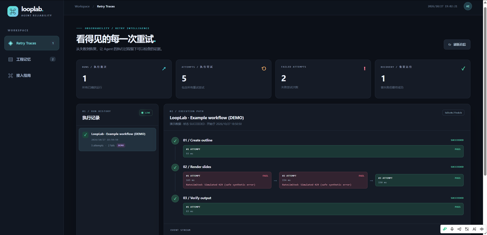
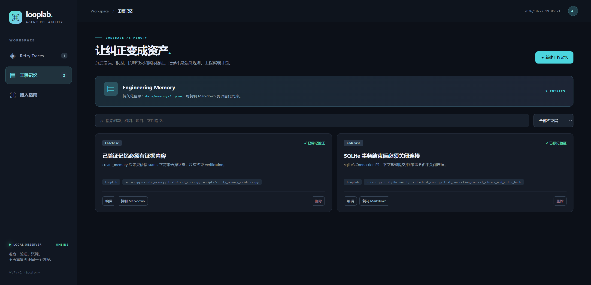
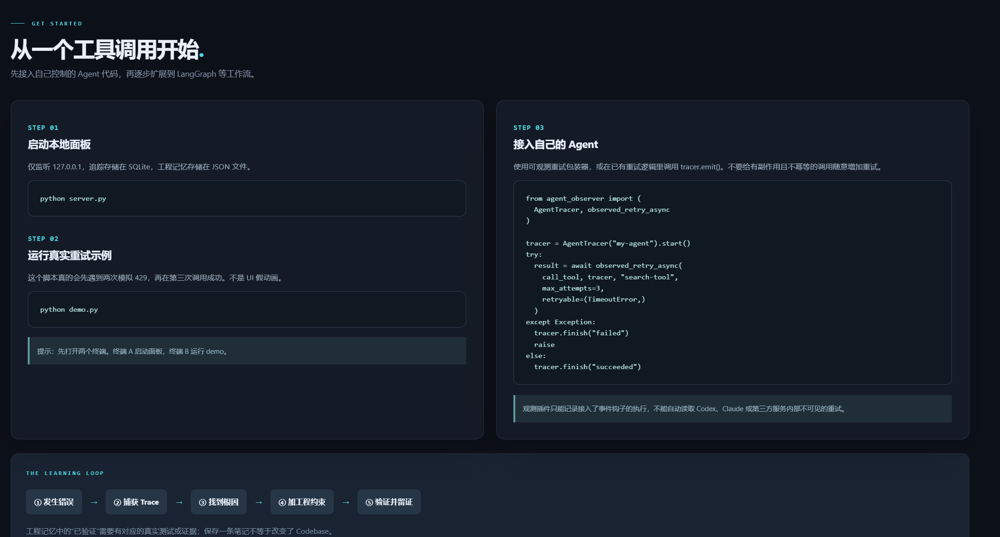

# agent-correcttion-loop

**LoopLab · Agent Retry Observer**

**English** · [简体中文](README.zh-CN.md)

A local dashboard that makes agent retries visible and turns corrections into engineering improvements backed by verification evidence.



*Demo workflow: two simulated failures followed by a successful retry. The dashboard shows actual locally recorded events, not production traffic.*

## What you can do

- **Observe retries:** inspect steps, attempts, errors, timings and final outcomes.
- **Preserve engineering lessons:** connect a problem to its root cause, code changes, prevention mechanism and verification evidence.
- **Build a correction loop:** execution → failure → correction → engineering constraint → verification.

## Start locally

Requires **Python 3.10+**. Download or clone this repository, open a terminal in its root, then run:

```bash
python server.py
```

Open [http://127.0.0.1:8765](http://127.0.0.1:8765). No third-party packages, API key or frontend build step is required.

To populate the retry view, run `python demo.py` in a second terminal. Its rate-limit errors are intentionally simulated and runs are labelled **DEMO**. The interface is currently in Simplified Chinese.

## Engineering memory

Save the **problem → root cause → prevention layer → code → verification evidence** in one place. Records can be edited, searched, filtered and copied as Markdown.



The backend rejects a verified record with empty evidence. Nonempty text still needs human or automated review to establish whether it is true; saving a note does not enforce a code change.

## The idea behind the project

Inspired by [the source video shared by @poteto](https://x.com/poteto/status/2102050467505430555): when correcting an agent, consider improvements in this order.

| Priority | Focus |
| --- | --- |
| **1. Codebase** | Make the correct path easy through safer APIs, data structures and boundaries. |
| **2. Static Analysis** | Enforce mechanically detectable constraints with lint, compiler or dependency checks. |
| **3. Rules / BugBot** | Add behavioral guidance and automated review. |
| **4. Skills** | Make application control and verification repeatable. |
| **5. Style Guide** | Document conventions without relying solely on reviewers' memory. |

LoopLab is an independent implementation inspired by these ideas, not the speaker's original product or an officially affiliated project. The [video notes](docs/video-notes.md) explain the distinction.

## A concrete correction

A local exercise found that records could be marked verified without evidence. Moving the constraint into the shared backend entrypoint protected both creation and editing. The same HTTP contract checks improved from **2/6 to 6/6**; the expanded unit suite passed **9/9**. See [verification details](docs/verification.md) for the tested scope and limitations.

<details>
<summary>View the in-app integration guide</summary>



</details>

## Further reading and scope

- [Feature map](docs/feature-map.md) · [Verification](docs/verification.md) · [Video notes](docs/video-notes.md)
- Only explicitly instrumented calls are visible; hidden agent retries, full agent trees and line-level code attribution are not captured automatically.
- The server is local-only and has no authentication. Keep secrets and private business data out of notes and exports.
- Trace visibility alone does not prove business correctness or performance. Delivery errors may be ignored, so traces are not a complete audit log.
- Runtime data defaults to `data/` and is excluded from Git. `OBSERVER_DATA_DIR` and `OBSERVER_PORT` configure storage and port.
